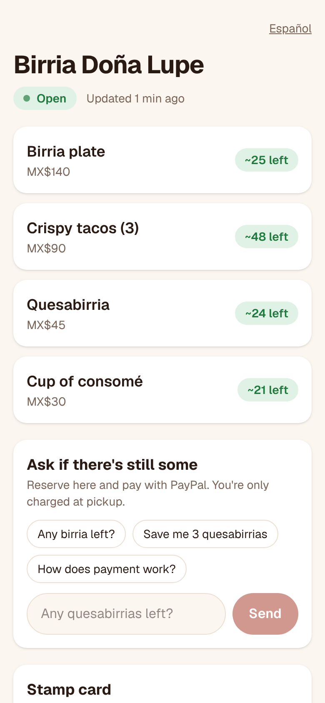
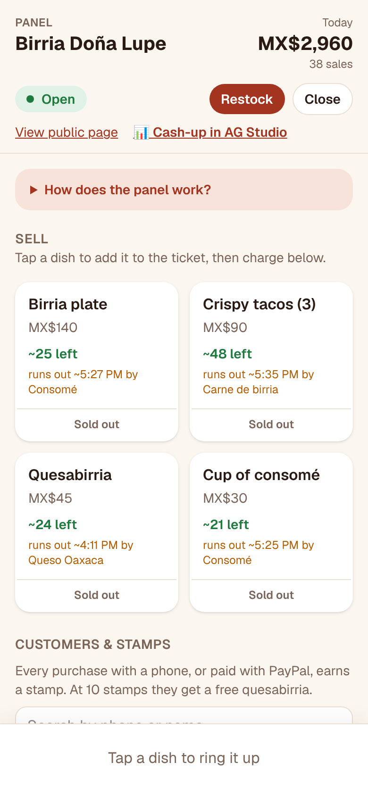
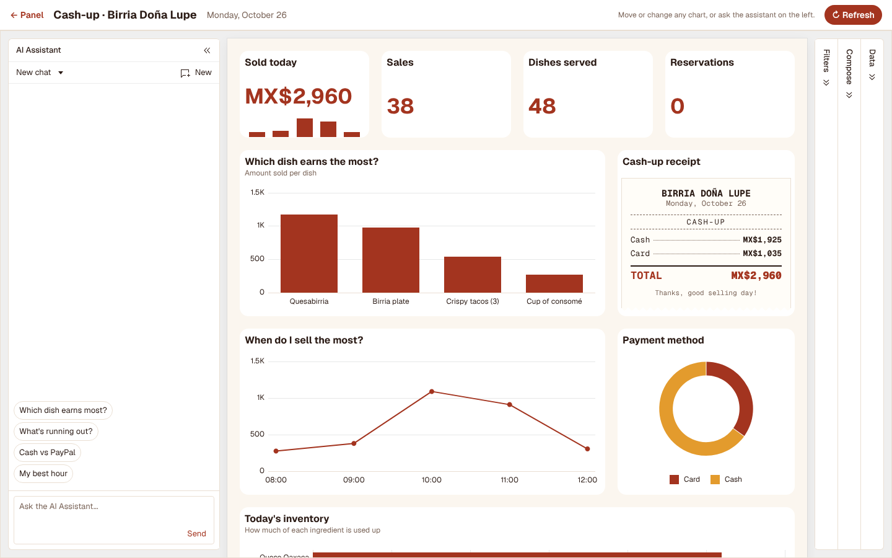

# ¿Todavía hay? ("Still got any?")

A point of sale and live menu for street food stalls that cook a batch in the morning and sell until it runs out. The owner rings up sales with one tap and every sale deducts ingredients by recipe. A public page shows, live, whether the stall is open and how many portions of each dish are left. An AI agent answers customers' "¿todavía hay?" and reserves their order with a PayPal payment that is held now and only charged when they pick it up.

Built for the [PayPal AI Hackathon](https://paypalaihackathon.devpost.com/).

**Live demo:** [public page](https://hachaton-paypal.onrender.com/en/birria-dona-lupe) · [owner panel](https://hachaton-paypal.onrender.com/en/panel/birria-dona-lupe) · [cash-up in AG Studio](https://hachaton-paypal.onrender.com/en/panel/birria-dona-lupe/corte). The demo stall is "Birria Doña Lupe"; switch between English and Spanish at the top of the public page. It runs on a free plan, so the first visit can take up to a minute to wake up. PayPal runs in sandbox mode.

| Public page | Owner panel | Cash-up in AG Studio |
| --- | --- | --- |
|  |  |  |

## The problem

A birria stall prepares, say, 12 kg of meat and sells until it's gone. Customers can't tell from home whether there's anything left, so some make the trip for nothing and others never come. Reserving ahead is risky for the stall because people don't show up. And at closing time the owner counts cash by hand, with no idea which dish actually paid off.

## What it does

**For customers** (public page, a PWA that works on any phone):

- See, live, whether the stall is open and roughly how many portions of each dish are left.
- Ask the agent in Spanish or English ("any quesabirrias left?", "save me 3") and reserve. PayPal holds the money and only charges it when the order is handed over. If they don't show up, the hold is released and they pay nothing.
- **"Avísame cuando haya"** (notify me): when the stall is closed or a dish is sold out, turn on a push alert. It is sent once, when the stall opens or the dish comes back.
- **Stamp card:** every paid order earns a stamp, and 10 stamps earn a free quesabirria. Reservations are matched to the payer's PayPal account; at the counter the customer gives their phone number.

**For the owner** (owner panel):

- One-tap sales with a running ticket, cash or card. Ingredients are deducted by recipe, including ingredients shared between dishes.
- Portions left and an estimated sell-out time per dish, with the ingredient that will run out first.
- Restock during the day, a "sold out" switch per dish, reservations to hand over ("Delivered" charges the PayPal hold), customers and their stamps.
- **Cash-up in AG Studio:** at closing, the day's sales, inventory and reservations open as a ready-made dashboard. An AI assistant in it answers questions like "which dish earns the most?" and can add charts.

## How it uses PayPal

Reservations use the Orders v2 API with `intent: AUTHORIZE` (`src/lib/paypal.ts`, `src/lib/reservations.ts`):

1. The agent creates the order and the customer approves it in PayPal. The funds are **authorized**, not captured.
2. The owner taps **Delivered** on pickup, and the app **captures** the authorization.
3. If the order isn't approved within 15 minutes or isn't picked up in time, the app **voids** the authorization, so the customer is never charged.

The payer id PayPal returns identifies the customer's stamp card, so a stamp is earned with no sign-up.

## How it uses AI

- **Customer agent** (`src/lib/agent.ts`): Gemini through the Vercel AI SDK. Every turn reads the live menu and stock, so the agent never promises what's gone. It reserves with a `reserve_order` tool that checks stock atomically in the database and starts the PayPal order.
- **Cash-up assistant** (`src/components/studio`): AG Studio's Agent Framework (`createAiHarness` with AG's built-in lead, data, page and widget agents). It runs on our own `AgLlmAdapter` (`geminiAdapter.ts`), which sends each turn to `/api/studio/llm`, so the Gemini key stays on the server. Each turn also carries the day's totals, so simple questions are answered in one step. There is a cap on tool calls so a small model can't loop.

## AG Studio

The cash-up page (`/[lang]/panel/[slug]/corte`) is built on AG Studio 3 (`ag-studio-react`):

- Three data sources (`ventas` sales, `inventario` inventory, `apartados` reservations) with typed, named, localized fields and currency, time and percent formats (`report.ts`).
- A dashboard that opens ready: four KPIs (sold today with an hourly sparkline, sales, dishes served, reservations), sales per dish, sales per hour, payment methods, share of each ingredient used, and a sales grid.
- A custom widget, **"Ticket del corte"**, drawn like the paper receipt a stall prints at closing (`TicketWidget.tsx`). It works with any category and amount, and the Studio agents can use it too.
- A theme in the stall's colours and fonts, a chart palette, and the editing panels collapsed so the owner sees the board first. On a phone it opens view-only.

## Tech

Next.js 16 (App Router, React 19) · Tailwind CSS 4 · Vercel AI SDK with Google Gemini · PayPal Orders v2 REST · Supabase (Postgres with row-level security and PL/pgSQL functions for atomic stock changes) · Web Push (VAPID) · AG Studio · Vitest · deployed on Render.

## Run locally

```bash
npm install
npm run dev      # http://localhost:3000/en/birria-dona-lupe and /en/panel/birria-dona-lupe
npm test
```

Without any keys the app runs on an in-memory store with a seeded demo day. The agent, PayPal and push alerts switch on as their keys are added:

| Variable | What for |
| --- | --- |
| `NEXT_PUBLIC_SUPABASE_URL`, `SUPABASE_SERVICE_ROLE_KEY` | Store data in Supabase instead of memory |
| `PAYPAL_CLIENT_ID`, `PAYPAL_CLIENT_SECRET` | Reservations with PayPal (sandbox unless `PAYPAL_ENV=live`) |
| `GOOGLE_GENERATIVE_AI_API_KEY` | Customer agent and cash-up assistant (Gemini) |
| `GEMINI_MODEL`, `STUDIO_GEMINI_MODEL` | Optional model overrides (both default to `gemini-flash-lite-latest`) |
| `VAPID_PUBLIC_KEY`, `VAPID_PRIVATE_KEY`, `VAPID_SUBJECT` | Push alerts; generate a pair with `npx web-push generate-vapid-keys` |
| `NEXT_PUBLIC_APP_URL` | Optional public URL for PayPal return links (otherwise taken from the request) |
| `NEXT_PUBLIC_AG_STUDIO_LICENSE` | AG Studio license key, read at build time; without it Studio shows a trial watermark |

To use Supabase, run the migrations in `supabase/migrations` in order (`0001` to `0005`) with `supabase db push` or the SQL editor. `0002` also creates the demo stall. **Reset demo** in the owner panel brings the stall back to a seeded day of sales.

## Roadmap

Offline sales with background sync, WhatsApp alerts, multiple employees and branches.

## License

[MIT](LICENSE)
